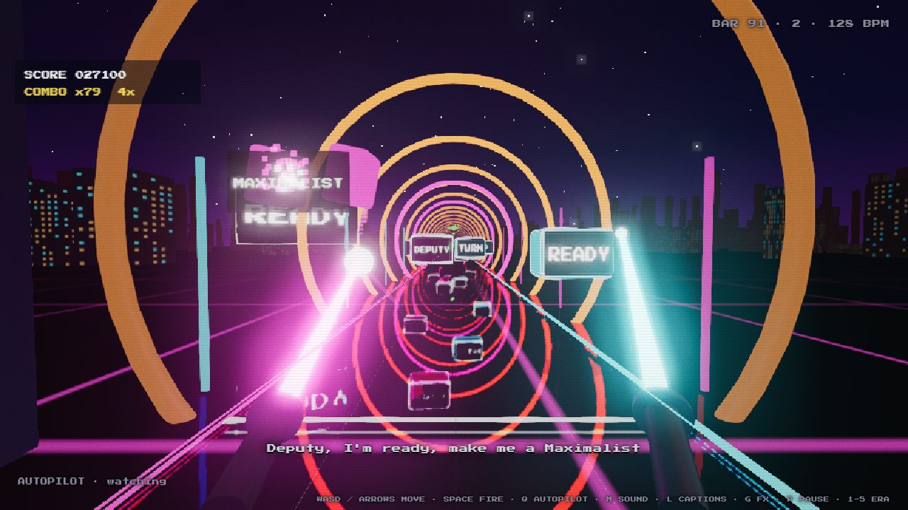
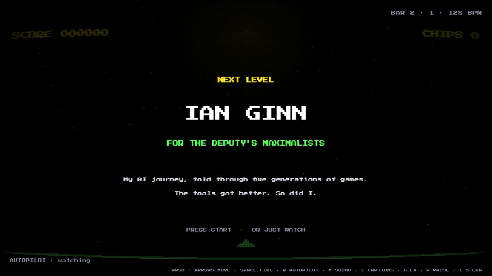
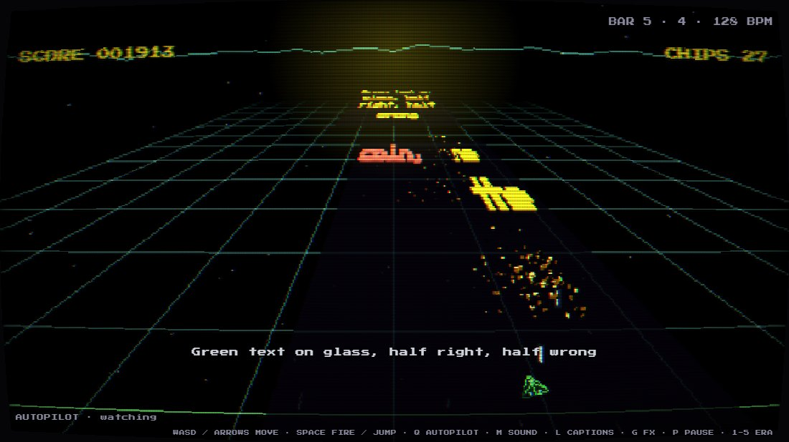
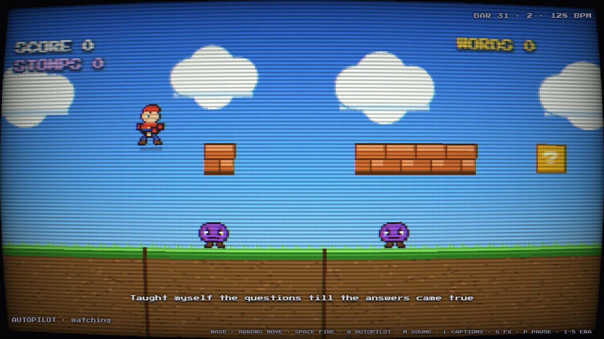
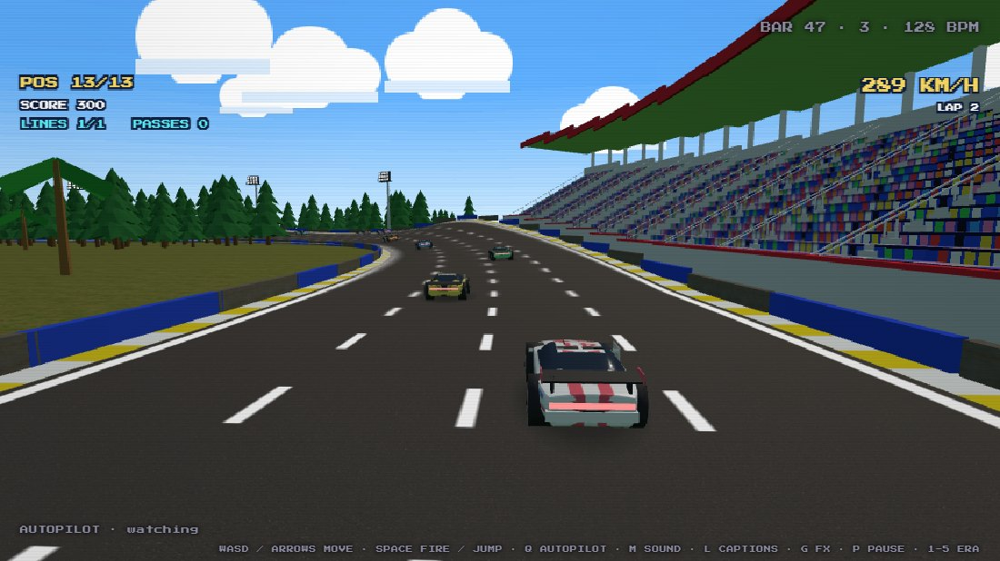
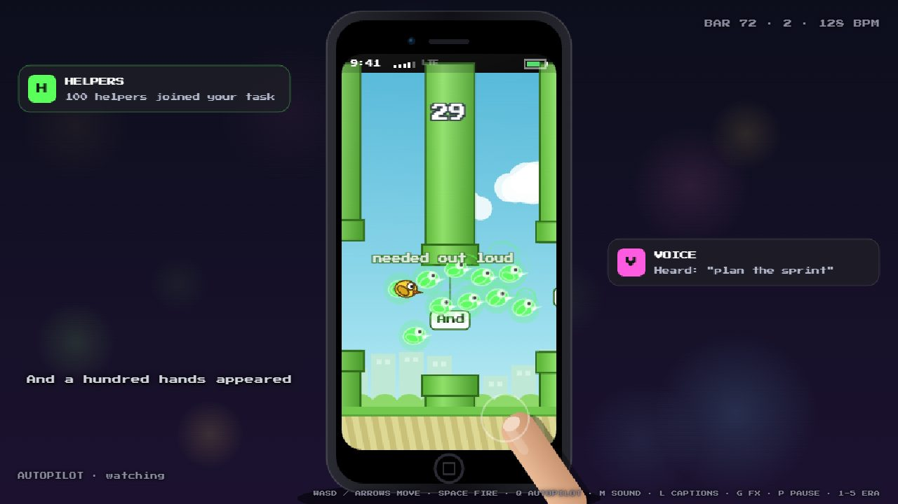
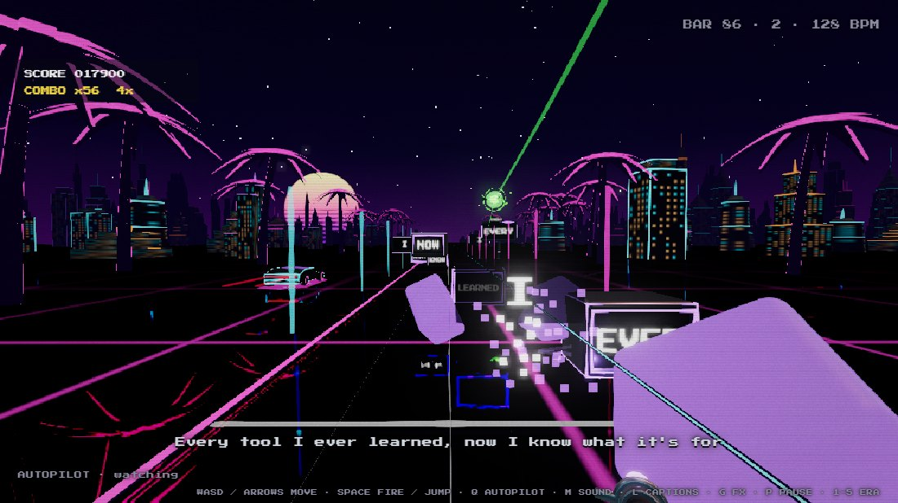
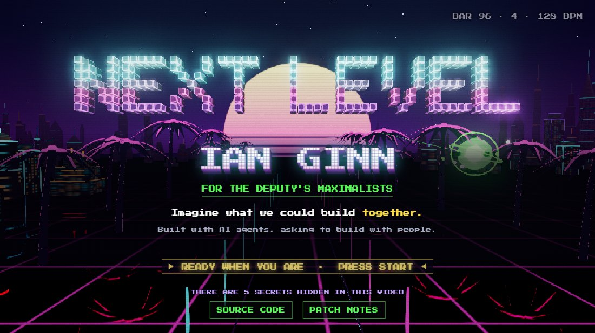

# Next Level



**Next Level** is a three-minute music video you can play. It is Ian Ginn's application to join the Deputy's Maximalists (Government of Alberta). Five generations of games stand for two curves rising together: what AI can do, and how well Ian uses it. The piece starts as a 1978 arcade crawl where you shoot the lyrics and ends in a VR saber lane where an AI co-pilot builds the arena out of every word you cut. The ask is the last chorus line, *"Deputy, I'm ready, next level, here I come"*, and the end card says *"Imagine what we could build together."*

- Play it now: https://trmytelabs.github.io/nextlevel/
- Coming soon: https://nextlevel.patchnotes.ca

It plays itself. Press a movement key or touch the screen to take over; autopilot picks back up after two idle seconds.



## The five eras

One continuous take, 96 bars at 128 BPM (one bar = 1.875 s, 3:00 total). Everything is timed in bars, and the lyrics are part of the gameplay in every era.

| Bars | Chapter | Era | How you play the lyrics |
|---|---|---|---|
| 0 to 19 | 1 · FIRST PROMPTS | 1978 arcade crawl on a phosphor CRT | The lyric lines come down the screen in a perspective crawl. Shoot to chip pixels off the words. |
| 19 to 37 | 2 · LEARNING TO ASK | 1991 Mario-style platformer | The runner autoruns on the ground. "?" blocks pop phrases of the lyric when hit from below; plain bricks break. |
| 37 to 56 | 3 · DIRECTING AGENTS | 1995 Daytona-style racer (Three.js) | One overhead gantry per lyric line. Drive under it in the lit lane to take the line. |
| 56 to 75 | 4 · WORKING FROM ANYWHERE | 2013 phone on a desk running a Flappy-style game | Words sit on signs in the pipe gaps. In the bridge, green ghost birds arrive and become the AI. |
| 75 to 96 | 5 · FULL DEVELOPMENT | Now: VR saber lane (Three.js), tunnel run for the last chorus | Word blocks fly in on the beat. Cut them with sabers that follow your mouse or finger while an AI co-pilot builds the arena out of the words. |

| | |
|---|---|
|  |  |
| **1 · First prompts.** The words are the enemies. | **2 · Learning to ask.** Phrases hide in "?" blocks. |
|  |  |
| **3 · At my desk.** One gantry per line. | **4 · In my pocket.** Ghost birds arrive in the bridge. |
|  |  |
| **5 · Directing agents.** Cut words become the arena. | **End card.** The camera cranes up over what you built. |

The "AI" in the finale is scripted, not live. Every playthrough is identical and every build lands on the beat.

## Controls

| Input | Action |
|---|---|
| A / D or Left / Right | Move, steer |
| W or Up | Jump |
| Space | Fire |
| Mouse (finale) | Moves the sabers: left half of the screen is the magenta hand, right half the cyan hand |
| Q | Autopilot: when idle / on / off |
| M | Sound on / off |
| L | Lyric captions on / off |
| G | Graphics tier high / low (reloads at the same bar; phones default to low) |
| P or Escape | Pause |
| 1 to 5 | Jump to an era |

**Phone** (landscape): hold the left or right edge to move, tap the top half to jump, tap the bottom half to fire. In the finale your finger moves the sabers. Portrait shows a rotate card. The page installs to the home screen via `public/manifest.webmanifest`.

## Run it

```bash
npm install
npx vite
```

Open http://localhost:5173/nextlevel/ (add `?q=high` or `?q=low` to force a graphics tier). `npm run build` type-checks and writes the static site to `dist/`.

## Verify

```bash
node tools/test/run.mjs
```

The harness drives the deterministic simulation through `window.ETM` in headless Edge with software WebGL. It checks for page errors, NaN state, era boundaries and the run reaching 3:00, then runs the case files in `tools/test/cases/` (spec: `tools/test/CASES.md`). Screenshots go to `tools/test/shots/`, the report to `tools/test/report*.json`.

| Flag | Effect |
|---|---|
| `--era N` | One era only (1 to 5) |
| `--from A --to B` | A bar range (`--chunk S` sets the step in seconds) |
| `--controls` | Keyboard and touch input mapping |
| `--mobile` | iPhone landscape layout checks plus the portrait rotate card |
| `--q low` | Low graphics tier |
| `--url URL` | Point at a dev server on another port |

Screenshot regression lives in `tools/test/visual/`: `node tools/test/visual/snap.mjs` compares frames against `baseline/` and writes diffs to `diff/`; `--update` accepts the current frames, `--bars 1,20,76` picks a subset, and `tolerances.json` sets per-frame tolerances. `.github/workflows/test.yml` runs the harness on every push.

In a browser console, `ETM.seek(bar*1.875); ETM.step(seconds); ETM.render(); ETM.probe()` drives the same simulation by hand.

## Deploy

- **Now:** every push to `main` runs `.github/workflows/pages.yml`, which builds and publishes `dist/` to GitHub Pages at https://trmytelabs.github.io/nextlevel/ (`vite.config.ts` sets `base` to `/nextlevel/`).
- **Next:** a VPS behind Caddy at https://nextlevel.patchnotes.ca. After the headless verification passes on `main`, `.github/workflows/deploy.yml` builds with `--base /` and rsyncs `dist/` to the server as a restricted `deploy` user (enabled by the `DEPLOY_ENABLED` repository variable). Server setup is in `deploy/`: `server-setup.sh`, the `Caddyfile` (HTTPS, security headers, CSP, caching) and `landing-deploy.md`.

## Soundtrack

Today the score is generative Web Audio (`src/music.ts`): square-wave arcade, FM 16-bit, rave, EDM plucks, then everything stacked, plus drums and SFX through a soft limiter. The real track is a Suno song written from the brief in `LYRICS.md` (lyrics, section tags, bar map). Drop it at `public/song.mp3` and the game runs off the audio clock; `[` / `]` nudge the offset, and T / U / Y tap lyric starts, clear taps and save `timing.json` (see `LYRICS.md`).

## Architecture

`index.html` holds the markup, CSS and HUD and loads `src/main.ts`. Every era exposes the same `init / update / draw / onBeat / on8th / onLine` surface, and `seek(t)` rebuilds every era's state from scratch at any time.

| File | Role |
|---|---|
| `src/main.ts` | Transport, compositing, transitions, title and end cards, HUD, the `window.ETM` test hook |
| `src/core.ts` | Constants, `ERAS`, `LYRICS`, seeded RNG, canvases, keyboard and touch input, quality tier |
| `src/music.ts` | Generative score |
| `src/song.ts` | Song clock for `public/song.mp3`, offset nudge, tap sync |
| `src/crt.ts` | WebGL CRT pass (curvature, scanlines, shadow mask) for eras 1 and 2 |
| `src/era1.ts` | Arcade crawl |
| `src/era2.ts` | Platformer |
| `src/era3.ts`, `src/era3gl.ts` | Racer simulation and its Three.js renderer (stadium, gantries, GLB stock cars) |
| `src/era4.ts` | Phone and Flappy-style game |
| `src/era5.ts`, `src/era5gl.ts` | Saber lane simulation (with 2D fallback) and its Three.js renderer |
| `src/world.ts` | Legacy, unused |

The simulation is deterministic: seeded hashes, never `Math.random`, in sim code. TypeScript runs with `strict` off. `tools/blender/car.py` builds the stock cars headlessly into `public/models/car_N.glb`.

## Credits

- Textures: CC0 from [Poly Haven](https://polyhaven.com) (see `public/textures/LICENSE.txt`)
- Font: [Press Start 2P](https://fonts.google.com/specimen/Press+Start+2P) by CodeMan38
- Rendering: [Three.js](https://threejs.org)
- Stock cars: modelled with [Blender](https://www.blender.org)
- Built by Ian Ginn with [Claude Code](https://claude.com/claude-code)
